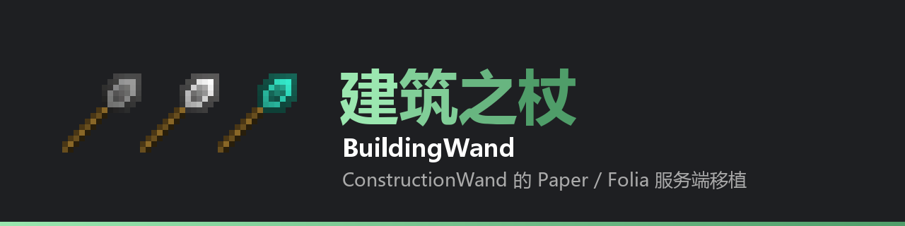
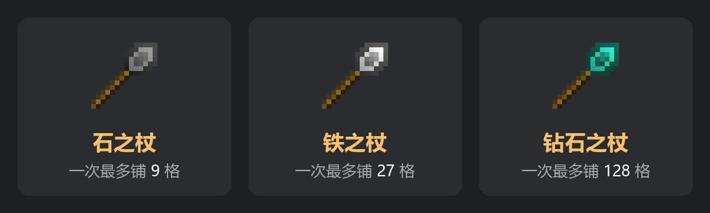
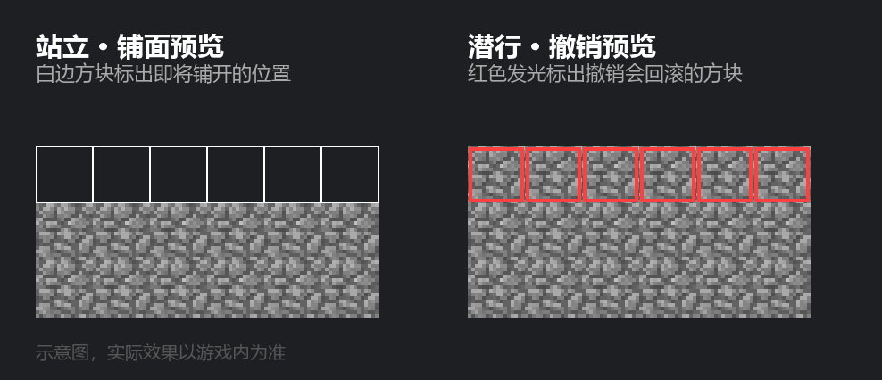
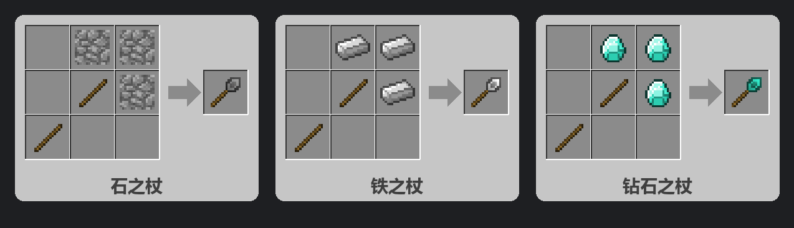
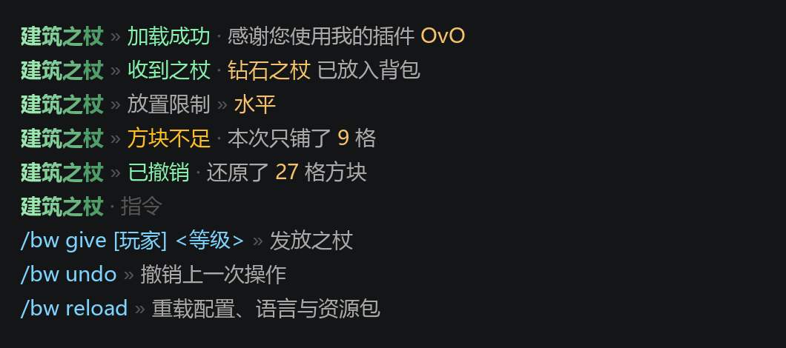

# BuildingWand



把 **ConstructionWand** 的建筑之杖带到 Paper / Folia 服务端：对着方块右键，沿着命中面一次铺开一整片同质方块，支持撤销与实时预览。

服务端实现，玩家不需要安装任何客户端模组。

---



## 功能

- **铺面建造** —— 右键方块，沿命中面洪泛铺开同质方块，最多 9 / 27 / 128 格（按之杖等级）
- **实时预览** —— 站着瞄准时，用半透明描边方块显示即将铺开的位置
- **撤销预览** —— 潜行时，用红色发光方块标出「这次撤销会回滚哪些方块」
- **逐次撤销** —— 潜行 + 左键，按操作逐次回滚，默认保留最近 3 次
- **背包供给** —— 放置的方块从背包扣除，可用物品不够时只铺到用完为止
- **耐久消耗** —— 每放一格扣一点耐久，耗尽后之杖直接消失
- **避让家具** —— 识别 CraftEngine 家具及其碰撞箱，铺面时不会把家具埋进方块里
- **可选项界面** —— 放置限制、朝向、是否替换、匹配模式、是否随机取物



## 环境要求

| 依赖 | 版本 |
|---|---|
| 服务端 | Paper / Folia 26.1.2、26.2、26.3（按服务端版本下载对应 jar） |
| CraftEngine | **硬前置**，之杖物品、模型、贴图、预览方块全部由它提供 |
| Java | 25+ |

> CraftEngine 是硬依赖：缺少它时插件会加载失败，因为所有物品本体都是 CE 物品而非原版物品。

## 安装

1. 从 [Releases](https://github.com/linmumua/BuildingWand/releases) 下载与服务端版本对应的 `BuildingWand-<版本>-mc<服务端版本>.jar`，放进 `plugins/` 目录
2. 确保 CraftEngine 已安装并正常运行
3. 启动服务端

插件启动时会把内置的 CraftEngine 资源包释放到 `plugins/CraftEngine/resources/buildingwand/`，日志会提示：

```
[BuildingWand] 已释放 CraftEngine 资源包到 plugins/CraftEngine/resources/buildingwand，请执行 /ce reload 使其生效。
```

此时执行 `/ce reload` 让 CraftEngine 读取该资源包。首次安装后玩家需要重新连接（或重新加载资源包）才能看到之杖模型。

## 指令

| 指令 | 说明 |
|---|---|
| `/bw give [玩家] <stone\|iron\|diamond>` | 发放指定等级的之杖 |
| `/bw undo` | 撤销自己最近一次操作 |
| `/bw reload` | 重载配置与语言，并重新释放 CraftEngine 资源包 |

别名：`/buildingwand`、`/wand`。

权限：`buildingwand.give`（发放）、`buildingwand.reload`（重载）、`buildingwand.debug`（预览诊断信息输出到聊天栏）。

## 操作

| 操作 | 效果 |
|---|---|
| 右键方块 | 沿命中面铺开 |
| 站着瞄准 | 显示铺面预览（半透明描边方块） |
| 潜行 | 显示撤销预览（红色发光方块） |
| 潜行 + 左键 | 撤销最近一次操作 |
| 潜行 + 滚轮 | 切换放置限制 |
| 潜行 + 右键空气 | 打开选项界面 |

## 合成

三档之杖共用同一个形状，材料按等级替换，各档独立合成：

```
 X A A      P = 木棍
 X P A      A = 该等级的材料
 P X X      X = 空
```

| 产物 | A |
|---|---|
| 石之杖 | 圆石 |
| 铁之杖 | 铁锭 |
| 钻石之杖 | 钻石 |



## 配置

主要配置项（完整注释见 `config.yml`）：

```yaml
wand:
  iron:
    durability: 250   # 耐久度，-1 表示不可破坏
    limit: 27         # 一次最多铺开的方块数

misc:
  max-range: 100      # 最大操作半径，防卡顿闸门
  undo-history: 3     # 撤销保留步数
  apply-physics: false # 放置方块时是否触发方块更新

preview:
  peek: 1.0                       # 预览方块显示高度：1 整格，0.5 半砖，最高 2，宽度不变
  build-glow: ''                  # 铺面预览发光色，留空不发光
  destroy-glow: '#FF4040'         # 撤销预览发光色
  build-material: 'buildingwand:preview'  # 预览方块外观，TARGET 表示用目标方块
```

`similar-blocks` 定义「同质方块」组：在 `SIMILAR` 匹配模式下，同组方块（例如泥土系列）会被视为同类一起铺开。

## 提示文本

全部提示使用 MiniMessage，集中在 `lang/zh_CN.yml`，可自由修改。



## 从源码构建

第三方依赖不随仓库分发，需要自行放置：

| 文件 | 位置 | 用途 |
|---|---|---|
| `craft-engine-paper-plugin-*.jar` | `libs/` | 编译期依赖 |
| `constructionwand-*.jar` | 项目根目录 | 生成 CraftEngine 资源包时提取模型与贴图 |

然后：

```bash
./gradlew build -Pmc=26.3   # 编译、跑测试、校验资源包；-Pmc 可选 26.1.2 / 26.2 / 26.3，默认 26.3
./gradlew verifyCePack   # 只校验 CraftEngine 资源包
```

产物在 `build/libs/BuildingWand-<插件版本>-mc<服务端版本>.jar`。

## 项目结构

```
src/main/java/cn/linmumua/buildingwand/
├── wand/            # 领域模型：坐标、面、锁模式、匹配、撤销历史
│   ├── action/      # 铺面算法（洪泛）
│   ├── supply/      # 背包/随机供给
│   └── undo/        # 有界撤销历史
├── task/            # 预览任务（铺面预览 + 撤销预览）
├── listener/        # 交互事件
├── gui/             # 选项界面
├── recipe/          # 合成配方
├── compat/          # CraftEngine 桥接、世界视图
└── config/          # 配置与语言

tools/
├── generate_ce_pack.py   # 生成 CraftEngine 资源包
├── verify_ce_pack.py     # 资源包校验
├── render_showcase.py    # 生成 docs/images 展示图（需本机 Minecraft 客户端 jar）
└── push_via_api.py       # github.com 不可达时经 API 推送

src/main/resources/craftengine/buildingwand/   # 内置的 CE 资源包
```

## 致谢

算法与美术资产源自 [ConstructionWand](https://github.com/Theta-Dev/ConstructionWand)（作者 ThetaDev）。本仓库是其 Paper / Folia 服务端移植实现。

## 许可

[MIT](LICENSE) — 沿用上游 ConstructionWand 的许可与版权声明（Copyright (c) 2021 ThetaDev）。
